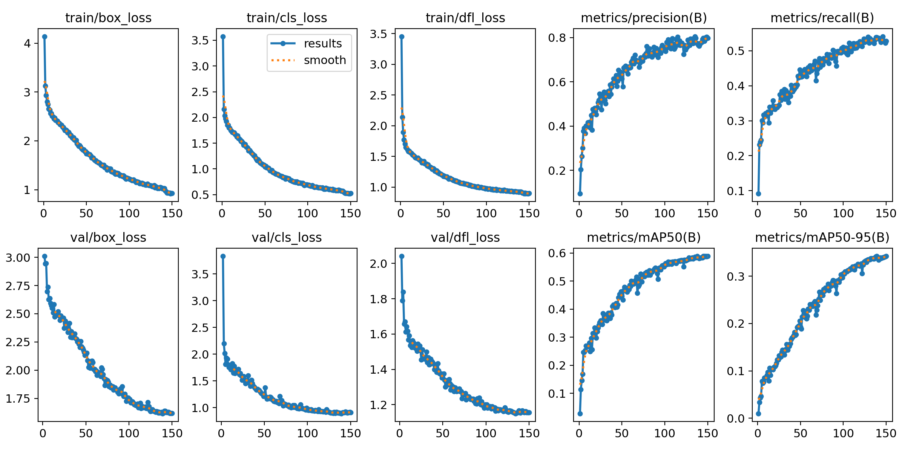
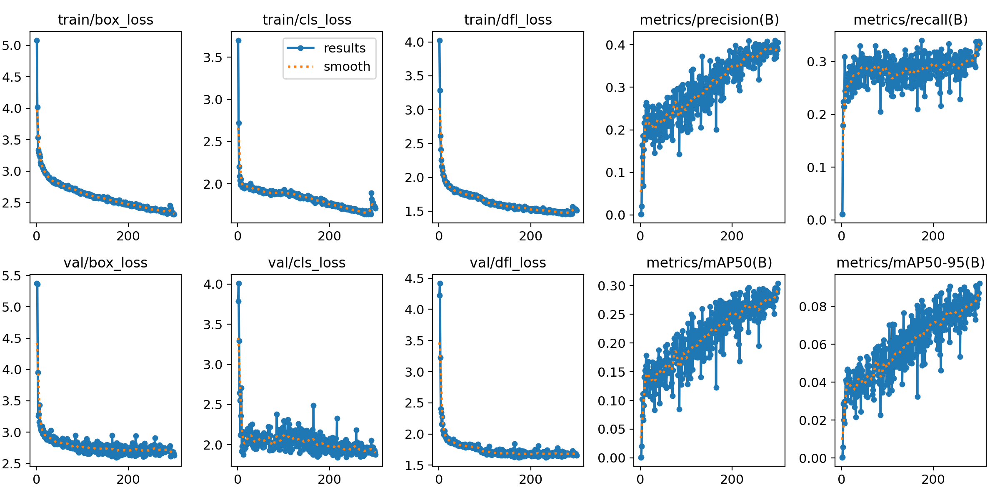
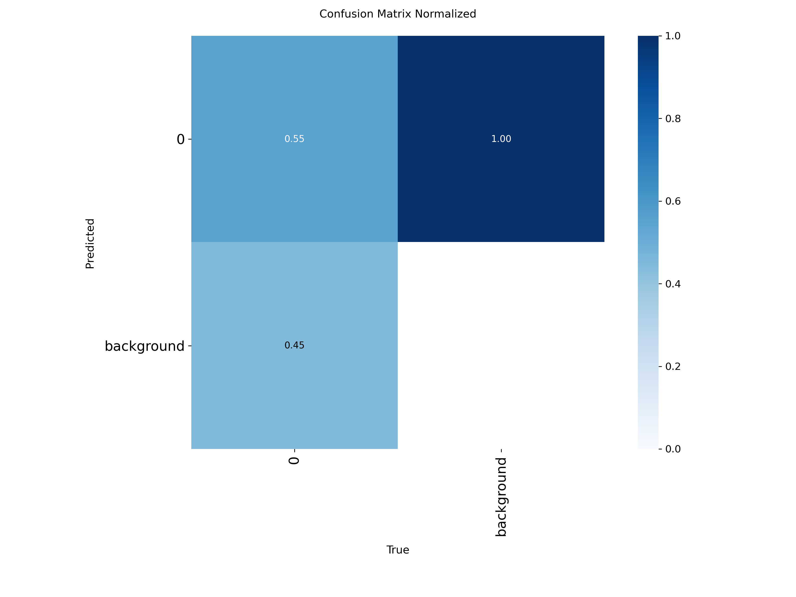
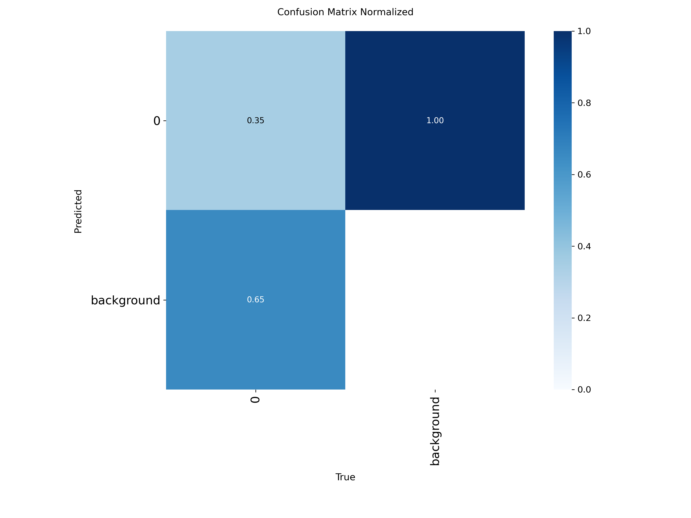
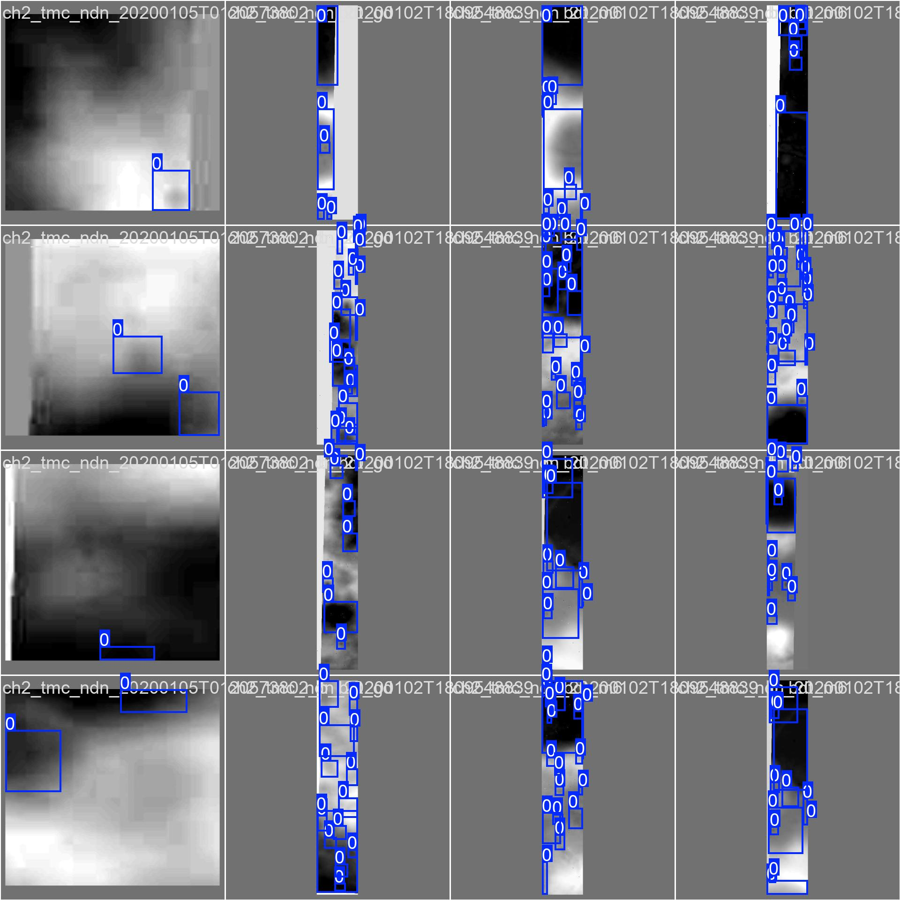
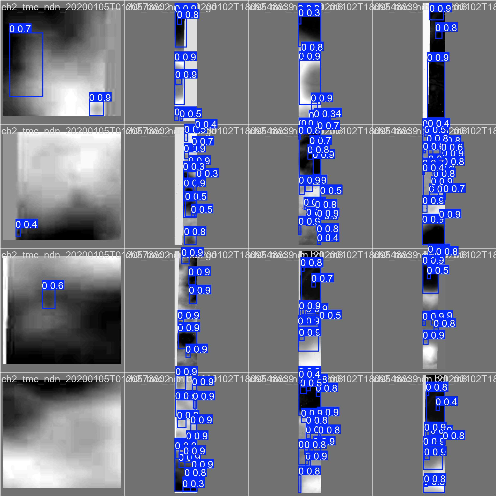
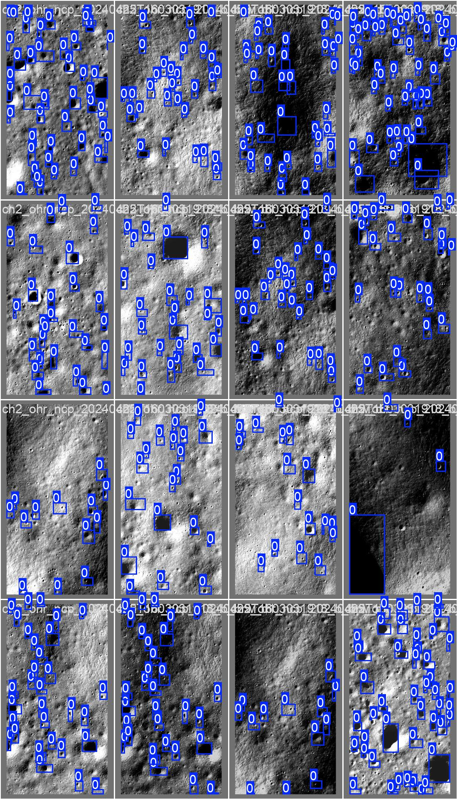
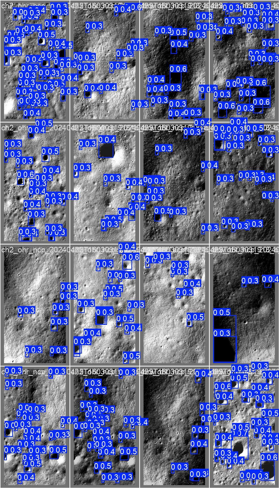

# Lunar Crater Detection (YOLOv11 + ResNet101)

A lunar crater detection pipeline built on **YOLOv11** with its default
backbone swapped for a **timm ResNet101**, trained on two Chandrayaan-2
datasets (OHRC and TMC-2).

Training runs on Google Colab (GPU required); this repo holds the notebooks,
config, and documentation needed to reproduce those runs.

> **Note:** No training is run from this repo. The notebooks in
> [`notebooks/`](notebooks/) are meant to be opened in Google Colab.

## What the project does

The pipeline detects impact craters in lunar surface imagery captured by
ISRO's Chandrayaan-2 orbiter. It trains two separate YOLOv11 object detectors
— one per camera/dataset — since OHRC and TMC-2 imagery differ enough in
resolution and crater scale that a single model handling both well is
impractical. Both models share the same architecture (yolo11.yaml) but are
trained independently with dataset-specific epoch counts.

## Architecture: why swap the backbone?

Stock YOLOv11 uses a CSPDarknet-style backbone trained from scratch (or from
COCO weights) alongside the rest of the network. This project instead plugs
in a **ResNet101 from the [timm](https://github.com/huggingface/pytorch-image-models)
library, pretrained on ImageNet**, as the feature extractor, and keeps
YOLOv11's neck (PANet-style FPN) and detection head unchanged.

The motivation, in plain terms:
- **Craters are low-contrast, texture-heavy targets.** A deeper, ImageNet-pretrained
  backbone brings feature representations already tuned to a huge variety of
  textures and edges, which transfers reasonably well to crater rims and
  shadows — useful when the labeled lunar dataset itself is small.
- **Transfer learning speeds up convergence.** Starting from ImageNet weights
  instead of random initialization typically needs fewer epochs to reach a
  usable detector, which matters when training on Colab's time-limited free
  GPUs.
- **timm gives easy access to well-tested backbone implementations** without
  having to hand-port ResNet into the Ultralytics codebase.

This required a small patch to Ultralytics itself — as of this writing, timm
backbone support isn't in a released version, only in
[PR #19609](https://github.com/ultralytics/ultralytics/pull/19609) (see
[Reproducing on Colab](#reproducing-on-colab) below).

### Reading `configs/yolo11.yaml`

```yaml
backbone:
  - [-1, 1, Timm, [2048, 'resnet101', True, True, 0, True]]  # 0: resnet101 backbone
  - [0, 1, Index, [512, 2]]     # 1: P3 - [1, 512, 80, 80]
  - [0, 1, Index, [1024, 3]]    # 2: P4 - [1, 1024, 40, 40]
  - [0, 1, Index, [2048, 4]]    # 3: P5 - [1, 2048, 20, 20]
  - [-1, 1, SPPF, [2048, 5]]    # 4: SPPF on P5
```

- **`Timm [2048, 'resnet101', True, True, 0, True]`** — instantiates a timm
  `resnet101` model as the backbone. In order, the arguments are: output
  channels (`2048`, used by Ultralytics' model parser for bookkeeping),
  the timm model name, `pretrained=True` (load ImageNet weights),
  `unwrap=True` (run in `features_only` mode so it returns intermediate
  feature maps instead of a classification logit), `truncate=0` (don't
  drop any trailing layers), and `split=True` (return the multi-scale
  features as a list so later layers can pick individual stages out of it).
- **`Index [C, i]`** — picks a single feature map out of that list by index
  `i` and tells the parser to expect `C` channels for it. A `features_only`
  ResNet101 in timm exposes 5 stages (strides 2/4/8/16/32); indices `2`, `3`,
  `4` correspond to strides 8, 16, 32 — i.e. the **P3, P4, P5** feature maps
  YOLO's neck expects, with `512`, `1024`, `2048` channels respectively.
- **`SPPF [2048, 5]`** — Spatial Pyramid Pooling – Fast, applied to the P5
  map. It pools the deepest feature map at multiple scales and concatenates
  the results, giving the network a wider receptive field before the neck
  starts up-sampling and merging P4/P3 — the same SPPF block stock YOLO
  models use, just re-attached after the ResNet101 output instead of after
  CSPDarknet.

The rest of the neck/head is stock YOLOv11: upsample-concat-C2f blocks
merging P5→P4→P3 top-down, then C2f-downsample blocks merging bottom-up
before the three-scale `Detect` head.

## Datasets

| | **OHRC** | **TMC-2** |
|---|---|---|
| Camera | Orbiter High Resolution Camera | Terrain Mapping Camera-2 |
| Ground resolution | ~0.25 m/pixel | ~5 m/pixel |
| Tile size | 304×640 px | 79×640 px |
| Annotation | Roboflow-assisted | Manual bounding boxes |
| Epochs trained | 300 | 150 |
| Roboflow project | `ch2-ohr` | `ch2-tmc` |

OHRC's much finer resolution captures small, detailed craters at the cost of
narrower ground coverage per tile; TMC-2 trades resolution for wider coverage,
so it tends to pick up larger craters across bigger areas per image. Training
the two separately keeps each model's anchors/scale expectations matched to
its own imagery instead of averaging across very different crater-to-pixel
ratios.

## Repo structure

```
.
├── notebooks/
│   ├── ohrc.ipynb       # OHRC dataset training notebook (Colab)
│   └── tmc2.ipynb       # TMC-2 dataset training notebook (Colab)
├── configs/
│   └── yolo11.yaml      # YOLOv11 model config with ResNet101/timm backbone
├── results/             # training curves + prediction samples go here (empty for now)
├── requirements.txt
└── README.md
```

## Reproducing on Colab

Both notebooks follow the same steps; only the Roboflow project and epoch
count differ.

1. **Open the notebook in Colab** (`notebooks/ohrc.ipynb` or
   `notebooks/tmc2.ipynb`) and switch the runtime to a GPU
   (`Runtime → Change runtime type → GPU`). The first cell (`!nvidia-smi`)
   confirms a GPU is attached.

2. **Set your own Roboflow API key.** The notebooks ship with the key
   replaced by `"YOUR_API_KEY"` — get your own key from your
   [Roboflow account settings](https://app.roboflow.com/) and paste it in:
   ```python
   rf = Roboflow(api_key="YOUR_API_KEY")
   ```
   Never commit a real key back into these notebooks.

3. **Check out the Ultralytics PR that adds timm backbone support**, since
   it isn't in a released version yet:
   ```bash
   git clone https://github.com/ultralytics/ultralytics
   cd ultralytics
   git fetch origin pull/19609/head:pr-19609
   git checkout pr-19609
   ```

4. **Copy `configs/yolo11.yaml` into the checked-out Ultralytics repo**, so
   it's discoverable as a model config by name:
   ```bash
   cp yolo11.yaml ultralytics/ultralytics/cfg/models/11/
   ```

5. **Load and train:**
   ```python
   from ultralytics import YOLO

   model = YOLO("yolo11.yaml")
   results = model.train(
       data="/content/<dataset>/data.yaml",
       epochs=300,   # 150 for TMC-2
       batch=8,
       imgsz=640,
   )
   ```

6. **Resuming across disconnects.** Colab sessions can drop before a
   150–300 epoch run finishes. To make that recoverable, mount Drive and
   point training output there instead of at local disk, then resume from
   the last checkpoint if the session restarts:
   ```python
   from google.colab import drive
   drive.mount("/content/drive")

   model.train(
       data="/content/<dataset>/data.yaml",
       epochs=300,
       batch=8,
       imgsz=640,
       project="/content/drive/MyDrive/lunar-crater-runs",
       resume=True,   # picks up from the last checkpoint in `project` if one exists
   )
   ```

7. **Save results.** Copy training curves (`results.png`, `confusion_matrix.png`,
   etc.) and a few prediction images from `runs/detect/train/` into this
   repo's [`results/`](results/) folder once a run finishes.

## Results

**Training setup:** all runs below were done on Kaggle (Tesla T4, 15GB),
using the Ultralytics PR #19609 branch (timm backbone support), with
`imgsz=640` and `batch=8`.

- **Custom model:** YOLOv11 with an ImageNet-pretrained ResNet101 backbone —
  **94.07M parameters**, 233.1 GFLOPs.
- **Baseline:** stock YOLOv11n — **2.58M parameters**.

Both are evaluated on their own validation split: TMC-2 (213 images / 2325
instances) and OHRC (92 images / 2946 instances).

| Model | Sensor | Epochs | mAP50 | mAP50-95 | Precision | Recall |
|---|---|---|---|---|---|---|
| YOLOv11n (baseline) | TMC-2 | 150 | 0.327 | 0.131 | 0.462 | 0.349 |
| YOLOv11n (baseline) | OHRC | 300 | 0.303 | 0.092 | 0.404 | 0.336 |
| YOLOv11+ResNet101 | TMC-2 | 150 | 0.589 | 0.343 | 0.798 | 0.528 |
| YOLOv11+ResNet101 | OHRC | 300 | 0.683 | 0.355 | 0.781 | 0.683 |
<!-- TODO ablation run: | YOLOv11+ResNet50 | TMC-2 | 150 | TBD | TBD | TBD | TBD | -->

**Comparison to the reference implementation:** the reference reports mAP50
of 0.587 (TMC-2) and 0.667 (OHRC). My TMC-2 run (0.589) reproduces that
almost exactly, and my OHRC run (0.683) slightly exceeds it.

**Key observations:**
- Swapping in the ResNet101 backbone nearly doubles mAP50 over the stock
  nano baseline on both sensors — but it costs 36x the parameters and
  roughly 5x the GPU inference time (1.9–3.3 ms → 10.2–15.3 ms per image on
  a T4).
- OHRC (~0.25 m/px) outperforms TMC-2 (~5 m/px) across every metric. The
  recall gap (0.683 vs 0.528) suggests the main failure mode on TMC-2 is
  missing small craters that get lost at coarser ground resolution, rather
  than false positives.
- On TMC-2 specifically, precision (0.798) is much higher than recall
  (0.528): the model rarely calls a crater where there isn't one, but it
  misses a fair number of real ones. Lowering the confidence threshold at
  inference time would trade some of that precision back for recall.

### Training curves

| TMC-2 (150 epochs) | OHRC (300 epochs) |
|---|---|
|  |  |
| TMC-2: mAP50 0.589 after 150 epochs | OHRC: mAP50 0.683 after 300 epochs |

### Confusion matrices

| TMC-2 (150 epochs) | OHRC (300 epochs) |
|---|---|
|  |  |
| TMC-2: normalized confusion matrix | OHRC: normalized confusion matrix |

### Sample predictions — ground truth vs model

| Ground truth | Prediction |
|---|---|
|  |  |
| TMC-2 validation batch 0 — ground truth | TMC-2 validation batch 0 — prediction |

| Ground truth | Prediction |
|---|---|
|  |  |
| OHRC validation batch 0 — ground truth | OHRC validation batch 0 — prediction |

More examples:
[TMC-2 batch 1 labels](results/tmc2_results/val_batch1_labels.jpg) ·
[TMC-2 batch 1 pred](results/tmc2_results/val_batch1_pred.jpg) ·
[TMC-2 batch 2 labels](results/tmc2_results/val_batch2_labels.jpg) ·
[TMC-2 batch 2 pred](results/tmc2_results/val_batch2_pred.jpg) ·
[OHRC batch 1 labels](results/ohrc_results/val_batch1_labels.jpg) ·
[OHRC batch 1 pred](results/ohrc_results/val_batch1_pred.jpg) ·
[OHRC batch 2 labels](results/ohrc_results/val_batch2_labels.jpg) ·
[OHRC batch 2 pred](results/ohrc_results/val_batch2_pred.jpg)

## CPU Inference Benchmark

Separate from the accuracy numbers above, I also benchmarked CPU-only
inference latency for both trained checkpoints, to see how they'd behave
without a GPU (e.g. for a lightweight demo or edge deployment).

**Setup:** AMD Ryzen 5 7530U (6 physical / 12 logical cores), `imgsz=640`,
20 timed runs after 3 warmup runs. ONNX Runtime sessions were tuned and
verified with `intra_op_num_threads=6`, `inter_op_num_threads=1`,
`ORT_ENABLE_ALL` (Ultralytics' own ONNX backend doesn't expose session
options, so this benchmark patches session construction to confirm the
tuned settings are actually applied rather than assuming it). See
[`benchmark.py`](benchmark.py).

| Variant | TMC-2 mean ms | OHRC mean ms | Speedup vs PyTorch |
|---|---|---|---|
| PyTorch CPU (FP32) | 1062 | 1352 | 1.00x |
| ONNX Runtime FP32 (tuned) | 1464 | 1577 | 0.73–0.86x |
| ONNX Runtime INT8 (dynamic) | 21235 | 21355 | 0.05–0.06x |

**Findings:**
- ONNX Runtime FP32 came out *slower* than plain PyTorch CPU, even with a
  tuned session. For a 94M-parameter, Conv-heavy backbone, PyTorch's own
  CPU kernels already perform well, and ONNX Runtime's CPU execution
  provider didn't beat them here.
- Dynamic INT8 quantization was 15–20x *slower*, not faster, and noticeably
  less accurate (detection counts on the eval set dropped 19–74% versus
  PyTorch). Reason: ONNX Runtime's dynamic quantization only ships fast
  INT8 kernels for MatMul-family ops (the kind that dominate transformers).
  This model is almost entirely Conv layers (the ResNet101 backbone), so
  those fall back to a slow dequantize-then-compute path instead of a real
  INT8 kernel — and dynamic quantization's uncalibrated, on-the-fly
  activation ranges hurt accuracy more on a deep conv net than they would
  on the op types it's actually designed for.
- File sizes shrink a lot even though speed doesn't: TMC-2's checkpoint
  goes from 180MB (`.pt`) → 359MB (ONNX FP32) → 90MB (INT8).
- The standard fix for this failure mode is **static, calibrated
  quantization** (QDQ format with a calibration dataset), which gives ONNX
  Runtime real per-tensor activation ranges instead of guessing them
  per-batch, and generally handles Conv-heavy nets much better than dynamic
  quantization. Deprioritized for now, but the obvious next step if CPU
  deployment becomes a priority.

## Reproducibility notes

Two mistakes I actually hit while setting this up — worth flagging for
anyone rerunning it:

1. **Silent fallback to stock nano scale.** If `configs/yolo11.yaml` isn't
   copied into `ultralytics/ultralytics/cfg/models/11/yolo11.yaml` *before*
   the model is built, Ultralytics doesn't error out — it silently falls
   back to its own built-in stock config at nano scale, only printing
   `WARNING ⚠️ no model scale passed. Assuming scale='n'.` Miss that
   warning and you can burn an entire training run on the wrong
   ~2.6M-parameter stock model instead of the ~94M-parameter ResNet101 one.
   **Always check the parameter count right after `YOLO(...)` and before
   calling `.train()`** — it should be ~94M, not ~2.6M.
2. **Import shadowing from the cloned PR branch.** Never run
   training/inference scripts from a working directory that also contains
   the cloned `ultralytics` repo folder itself. Python resolves
   `import ultralytics` against that local folder before the installed
   package, so you'll either get a confusing
   `cannot import name 'YOLO' from 'ultralytics' (unknown location)` error,
   or silently load the wrong copy. Either `cd` into the clone before
   installing/using it, or keep it in a subfolder (e.g.
   `vendor/ultralytics`) that isn't itself on the working directory's
   import path.

## Demo

🚀 Live demo : https://lunar-crater-detection.streamlit.app

Planned: a small Gradio app — upload a lunar tile, adjust the confidence
threshold, and see detections drawn with approximate real-world crater
diameters (computed from the sensor's known ground resolution).

## Credits & License

Imagery courtesy of ISRO's Chandrayaan-2 mission (OHRC and TMC-2 instruments).
Timm backbone support in Ultralytics via
[PR #19609](https://github.com/ultralytics/ultralytics/pull/19609).

This project is released under the MIT License.
